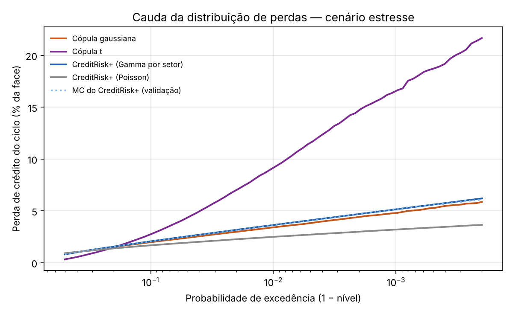
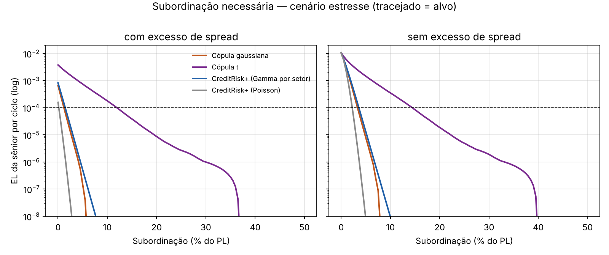

# Risco de crédito em FIDCs de duplicatas — CreditRisk+, cópulas e subordinação

Repositório de **código, metodologia, outputs e artefatos reprodutíveis** do estudo sobre perda esperada, perda
inesperada e dimensionamento da subordinação em FIDCs de recebíveis (duplicatas), usando o **CreditRisk+** como
modelo principal e **cópulas gaussiana e t** (família Merton/Vasicek) como comparativo.

> **Transparência:** o objetivo é permitir que cada número apresentado seja rastreado até a execução
> computacional que o produziu. Veja `docs/MANIFESTO_DE_EVIDENCIAS.md`.

> **Natureza dos dados:** toda a carteira é **sintética (hipotética)**. Esta versão (`v0.1.0`) é o esqueleto
> metodológico validado; ainda **não** há calibração com dados reais de fundos.

## Pergunta de pesquisa

O deságio cobrado na compra de duplicatas precisa cobrir `custo do dinheiro + perda esperada + custos + margem`.
A perda esperada (EL) é a **média** da distribuição de perdas; o **tamanho da subordinação** depende da **cauda**.
O estudo mede como a escolha do modelo (Poisson, Gamma por setor, cópulas) muda a cauda e, com ela, a subordinação
necessária para proteger a cota sênior.

## Snapshot (`v0.1.0`)

- seed: **20261003**; 600 sacados; ciclo de 60 dias; LGD 60%; 100.000 simulações por modelo;
- PL ≈ R$ 98,9 mi, face ≈ R$ 103,9 mi (deságio de 5,06% sobre o preço = 2,5% a.m. por 2 meses);
- estrutura de exemplo: 80% sênior (CDI + 3%), 20% subordinada, despesas de 2% a.a.;
- cenários: `base` e `estresse` (PD × 3 e volatilidade dos fatores setoriais × 1,5).

### Resultados-chave (perda de crédito do ciclo, % da face)

| Cenário | Modelo | EL | VaR 99% | VaR 99,9% | ES 99,9% |
|---|---|---|---|---|---|
| base | CreditRisk+ Poisson | 0,315 | 1,28 | 1,82 | 2,03 |
| base | **CreditRisk+ Gamma (setores)** | 0,315 | 1,39 | 2,00 | 2,25 |
| base | Cópula gaussiana | 0,316 | 1,37 | 1,93 | 2,18 |
| base | Cópula t (ν = 5)* | 0,312 | 4,71 | 11,49 | 14,07 |
| estresse | CreditRisk+ Poisson | 1,004 | 2,49 | 3,20 | 3,48 |
| estresse | **CreditRisk+ Gamma (setores)** | 1,004 | 3,64 | 5,15 | 5,80 |
| estresse | Cópula gaussiana | 1,005 | 3,41 | 4,81 | 5,47 |
| estresse | Cópula t (ν = 5)* | 1,014 | 9,15 | 16,55 | 19,74 |

\* A cópula t usa o **mesmo `rho` de ativos** das gaussiana, mas tem correlação de default e dependência de cauda
muito maiores; ela é um teste de robustez, **não** um comparativo à mesma correlação de default (ver `docs/METODOLOGIA.md`, seção 3).

Leituras que o snapshot sustenta:

1. A **EL é praticamente idêntica** entre os modelos (por construção); o que muda é a **cauda**.
2. Ignorar a correlação setorial (Poisson puro) **subestima** o VaR 99,9% em ~9% no cenário base e ~38% no estresse, em relação ao Gamma por setor.
3. Com a correlação de default casada, **CreditRisk+ Gamma e cópula gaussiana ficam próximos** (diferença de 4–7% no VaR 99,9%), como a literatura de comparação de modelos sugere.
4. A conclusão sobre subordinação é **muito sensível à hipótese de cauda** (cópula t).

### Subordinação mínima (EL da sênior ≤ 0,01% por ciclo, % do PL)

| Cenário | Modelo | com excesso de spread | sem excesso de spread |
|---|---|---|---|
| base | CreditRisk+ Poisson / Gamma / cópula gaussiana | 0,0% / 0,0% / 0,0% | 1,5% / 1,5% / 1,5% |
| base | Cópula t | 6,5% | 8,5% |
| estresse | CreditRisk+ Poisson | 0,5% | 2,5% |
| estresse | CreditRisk+ Gamma | 1,5% | 4,0% |
| estresse | Cópula gaussiana | 1,5% | 3,5% |
| estresse | Cópula t | 12,0% | 14,5% |

Regra de mercado "subordinação = k × EL" (`outputs/regra_multiplos_el.csv`): base 1,0–1,7% do PL; estresse 3,2–5,3% (k = 3 a 5).
O excesso de spread do ciclo (≈ 2,6% do PL nas premissas) é o primeiro colchão; **na leitura sem XS** (conservadora) a subordinação
mínima é a que fica comparável com a regra de múltiplos.

### Validação da implementação

| Checagem | Base | Estresse |
|---|---|---|
| Distância KS entre Panjer e Monte Carlo do mesmo modelo (limite DKW α=10⁻³: 0,0062) | 0,0021 | 0,0034 |
| Inclinação log-log do RMSE da EL do MC (referência teórica −0,500) | −0,491 | −0,472 |
| Média e variância da pmf vs. fórmula fechada | coincidem | coincidem |




## Como reproduzir

Python 3.11+ recomendado.

```bash
python -m pip install -r requirements.txt
python -m pytest -q                       # testes de unidade
python pipeline_fidc_creditrisk.py        # ~10 s; use --rapido para uma execução curta
python scripts/verify_output.py           # invariantes dos outputs
python scripts/generate_figures.py        # figuras de auditoria
```

## Estrutura

```
fidc-creditrisk-modelagem/
├── pipeline_fidc_creditrisk.py     # orquestra cenários, modelos e outputs
├── config_snapshot.json            # TODOS os parâmetros e a seed
├── requirements.txt
├── src/fidc_risk/
│   ├── portfolio.py                # carteira sintética, cenários, PD do ciclo
│   ├── creditriskplus.py           # bandas, recursão de Panjer, setores Gamma, MC do mesmo modelo
│   ├── copula.py                   # cópulas gaussiana/t por setor, calibração, Vasicek
│   ├── waterfall.py                # cascata sênior/subordinada, curva de subordinação
│   └── metrics.py                  # EL, VaR, ES (discreto e amostral)
├── tests/                          # testes de unidade
├── scripts/                        # verify_output.py, generate_figures.py
├── outputs/                        # CSV/JSON gerados (ver manifesto)
├── figures/
├── docs/                           # METODOLOGIA.md, MANIFESTO_DE_EVIDENCIAS.md
├── .github/workflows/ci.yml
├── CITATION.cff
└── CHANGELOG.md
```

## Roteiro

- [ ] Calibração agregada com os **informes mensais de FIDC da CVM** (inadimplência por faixa de atraso, PDD, composição das classes) — primeiro dado empírico do projeto.
- [ ] **Diluição** como segundo componente de perda (devoluções e abatimentos).
- [ ] **Coobrigação**: perda só se sacado e cedente falharem, com correlação entre ambos como parâmetro.
- [ ] **Revolvência**: composição de ciclos e gatilhos (evento de avaliação/liquidação).
- [ ] Cópula t calibrada pela mesma correlação de default; cópula de Clayton como terceiro comparativo.
- [ ] Slides e artigo.

## Autor

**Davi Henrique de Souza Amâncio** — Licenciatura em Matemática, IFC Campus Camboriú.

## Aviso

Finalidade acadêmica e educacional. Os resultados vêm de uma carteira sintética e de premissas ilustrativas; não constituem
estimativa de perdas de fundo real, recomendação de investimento nem oferta de produto financeiro.
