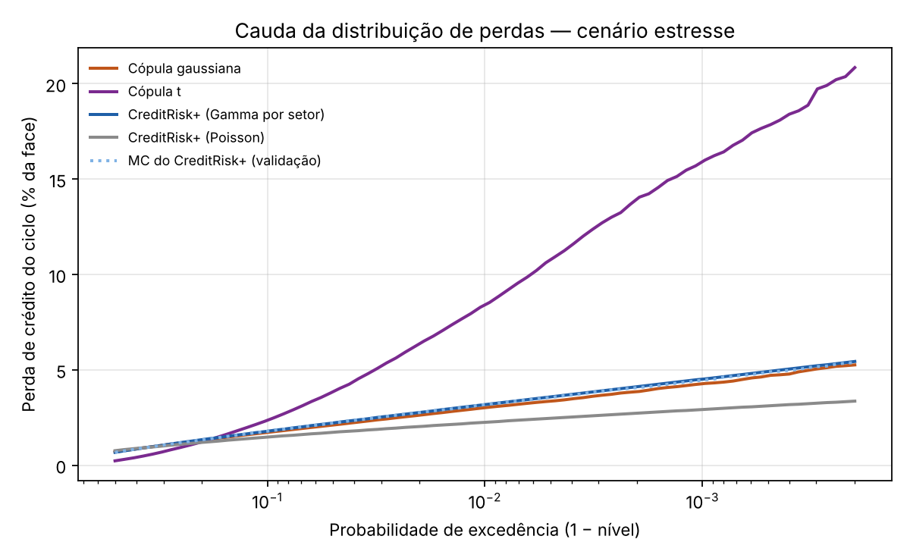
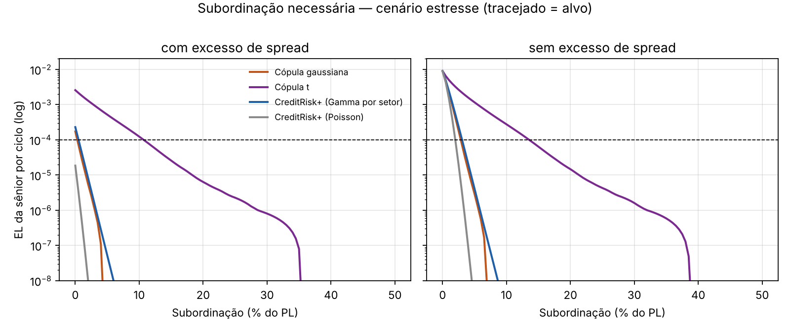

# Risco de crédito em FIDCs de duplicatas — CreditRisk+, cópulas e subordinação

Repositório de **código, metodologia, outputs e artefatos reprodutíveis** do estudo sobre perda esperada, perda
inesperada e dimensionamento da subordinação em FIDCs de recebíveis (duplicatas), usando o **CreditRisk+** como
modelo principal e **cópulas gaussiana e t** (família Merton/Vasicek) como comparativo. A partir da `v0.2.0`, o
deságio e o prazo médio vêm de **dados públicos de mercado** (Quick Soft, via imprensa especializada) e o modelo
decompõe a taxa em funding, custos, perda esperada e margem.

> **Transparência:** cada número apresentado deve ser rastreável até a execução que o produziu
> (`docs/MANIFESTO_DE_EVIDENCIAS.md`). As tabelas deste README são geradas pelo pipeline e conferidas por
> `scripts/verify_output.py`.

> **Natureza dos dados:** a **carteira de sacados é sintética (hipotética)**. Só o deságio, o prazo médio e o
> contexto macro são **dados de mercado** (fonte única, não auditada, ver `docs/FONTES_EXTERNAS.md`). Não há ainda
> calibração de PD/LGD com dados de fundos reais.

## Pergunta de pesquisa

O deságio cobrado na compra de duplicatas precisa cobrir `custo do dinheiro + perda esperada + custos + margem`.
A perda esperada (EL) é a **média** da distribuição de perdas; o **tamanho da subordinação** depende da **cauda**.
O estudo mede (i) como a escolha do modelo (Poisson, Gamma por setor, cópulas) muda a cauda e a subordinação
necessária e (ii) quanto da taxa de mercado a EL modelada explica.

## Snapshot (`v0.2.0`)

- seed **20261003**; 600 sacados sintéticos; LGD 60%; 100.000 simulações por modelo;
- **deságio de 2,92% a.m. e prazo médio de 50,8 dias** (setembro/2026, Quick Soft). O ciclo do modelo tem 50,8 dias;
- PL ≈ R$ 99,0 mi, face ≈ R$ 103,9 mi (deságio de 4,99% sobre o preço no ciclo);
- estrutura de exemplo: 80% sênior (CDI + 3%), 20% subordinada, despesas de 2% a.a.;
- CDI de 13,65% a.a. = Selic meta de 13,75% menos 0,10 p.p. (**aproximação**, ver `config_snapshot.json`);
- cenários de risco: `base` e `estresse` (PD × 3 e volatilidade dos fatores setoriais × 1,5).

### 1. Dados de mercado usados (Quick Soft)

| Mês | Deságio a.m. | Prazo médio (dias) | Observação |
|---|---|---|---|
| 2025-09 | 3,00% | n/d | início da série |
| 2026-04 | 2,75% | 50,89 | |
| 2026-05 | 2,77% | 50,44 | |
| 2026-07 | n/d | 46,50 | menor prazo da série |
| 2026-08 | 2,74% | 49,20 | |
| 2026-09 | **2,92%** | **50,80** | maior alta mensal (+0,18 p.p.) |

A série completa, com fonte de cada ponto, está em `data/mercado_quicksoft.csv` e `data/fontes_mercado.csv`.
**Limites:** são cerca de 13 meses de uma só plataforma, a metodologia não é pública e a taxa é a paga pelo
**cedente** (não é retorno de FIDC).

### 2. Decomposição da taxa: o que o deságio de mercado paga

Por ciclo, em % do PL: `receita de deságio = funding da sênior + custos + EL do modelo + margem residual`.
A **capacidade de perda** é o que sobra depois de funding e custos.

<!-- BEGIN:tabela_decomposicao -->
| Cenário | Mês | Deságio a.m. | Prazo (dias) | Receita de deságio | Funding sênior | Custos | **Capacidade de perda** | EL do modelo | Margem residual | EL / capacidade |
|---|---|---|---|---|---|---|---|---|---|---|
| base | 2026-04 | 2,75% | 50,89 | 4,71% | 1,76% | 0,28% | **2,67%** | 0,28% | 2,39% | 10,5% |
| base | 2026-05 | 2,77% | 50,44 | 4,70% | 1,75% | 0,28% | **2,68%** | 0,28% | 2,40% | 10,4% |
| base | 2026-08 | 2,74% | 49,20 | 4,53% | 1,70% | 0,27% | **2,56%** | 0,27% | 2,29% | 10,6% |
| base | 2026-09 | 2,92% | 50,80 | 4,99% | 1,76% | 0,28% | **2,96%** | 0,28% | 2,68% | 9,5% |
| estresse | 2026-04 | 2,75% | 50,89 | 4,71% | 1,76% | 0,28% | **2,67%** | 0,89% | 1,77% | 33,5% |
| estresse | 2026-05 | 2,77% | 50,44 | 4,70% | 1,75% | 0,28% | **2,68%** | 0,89% | 1,79% | 33,1% |
| estresse | 2026-08 | 2,74% | 49,20 | 4,53% | 1,70% | 0,27% | **2,56%** | 0,86% | 1,70% | 33,7% |
| estresse | 2026-09 | 2,92% | 50,80 | 4,99% | 1,76% | 0,28% | **2,96%** | 0,90% | 2,06% | 30,3% |
<!-- END:tabela_decomposicao -->

<!-- BEGIN:tabela_equilibrio -->
| Cenário | Capacidade de perda por ano (% do PL) | EL do modelo por ano (% do PL) | PD anual de equilíbrio (homogênea) | PD anual média da carteira |
|---|---|---|---|---|
| base | 21,0% | 2,0% | 28,9% | 3,1% |
| estresse | 21,0% | 6,3% | 28,9% | 9,2% |
<!-- END:tabela_equilibrio -->

Leituras que as tabelas sustentam:

1. Em setembro/2026, o deságio de mercado paga **≈ 21% do PL por ano** em perdas e margem (após funding e custos),
   contra uma EL modelada de **2,0% (base) e 6,3% (estresse)** do PL por ano. A EL explica 9% a 30% da capacidade.
2. A **PD anual homogênea de equilíbrio** (margem zero) é de **28,9%**, muito acima da PD média sintética (3,1% base, 9,2% estresse).
3. A margem residual de 2,1% a 2,7% do PL por ciclo **não é lucro**: ela absorve o que o modelo ainda não cobre
   (diluição, risco do cedente, custos operacionais e tributos adicionais, caixa ocioso). Medir isso é o próximo passo (roteiro).

### 3. A alta de setembro veio da taxa ou do prazo?

Decomposição da variação da capacidade de perda **anualizada** entre meses consecutivos:

<!-- BEGIN:tabela_efeito_taxa_prazo -->
| Variação | Deságio a.m. | Prazo (dias) | Δ capacidade de perda anual (p.p. do PL) | efeito da taxa | efeito do prazo | interação |
|---|---|---|---|---|---|---|
| 2026-04 → 2026-05 | 2,75% → 2,77% | 50,89 → 50,44 | +0,24 | +0,24 | -0,01 | 0,00 |
| 2026-08 → 2026-09 | 2,74% → 2,92% | 49,20 → 50,80 | +2,22 | +2,20 | +0,02 | 0,00 |
<!-- END:tabela_efeito_taxa_prazo -->

De agosto para setembro, praticamente toda a variação vem da **taxa mensal**; o prazo explica cerca de 0,02 p.p.
Ou seja, nesta métrica o aumento de prazo (49,2 → 50,8 dias) **não** explica a alta do deságio.

### 4. Perda de crédito do ciclo por modelo (% da face)

<!-- BEGIN:tabela_perdas -->
| Cenário | Modelo | EL | VaR 99% | VaR 99,9% | ES 99,9% |
|---|---|---|---|---|---|
| base | CreditRisk+ Poisson | 0,267 | 1,18 | 1,68 | 1,90 |
| base | CreditRisk+ Gamma (setores) | 0,267 | 1,27 | 1,85 | 2,08 |
| base | Cópula gaussiana | 0,267 | 1,25 | 1,78 | 2,00 |
| base | Cópula t (ν = 5) | 0,264 | 4,22 | 10,89 | 13,47 |
| estresse | CreditRisk+ Poisson | 0,853 | 2,25 | 2,92 | 3,19 |
| estresse | CreditRisk+ Gamma (setores) | 0,853 | 3,18 | 4,51 | 5,09 |
| estresse | Cópula gaussiana | 0,853 | 3,02 | 4,28 | 4,86 |
| estresse | Cópula t (ν = 5) | 0,861 | 8,39 | 15,93 | 18,89 |
<!-- END:tabela_perdas -->

A cópula t usa o **mesmo `rho` de ativos** da gaussiana, mas tem correlação de default e dependência de cauda muito
maiores; ela é um teste de robustez, **não** um comparativo à mesma correlação de default (`docs/METODOLOGIA.md`, seção 3).

1. A **EL é praticamente idêntica** entre os modelos (por construção); o que muda é a **cauda**.
2. Ignorar a correlação setorial (Poisson puro) **subestima** o VaR 99,9% em ~9% (base) e ~35% (estresse) frente ao Gamma por setor.
3. Com a correlação de default casada, a **cópula gaussiana fica ~4% a 5% abaixo** do CreditRisk+ Gamma no VaR 99,9%.
4. A conclusão sobre subordinação é **muito sensível à hipótese de cauda** (cópula t).

### 5. Subordinação mínima (EL da sênior ≤ 0,01% por ciclo, % do PL)

<!-- BEGIN:tabela_subordinacao -->
| Cenário | Modelo | com excesso de spread | sem excesso de spread |
|---|---|---|---|
| base | CreditRisk+ Poisson | 0,0% | 1,0% |
| base | CreditRisk+ Gamma (setores) | 0,0% | 1,0% |
| base | Cópula gaussiana | 0,0% | 1,0% |
| base | Cópula t (ν = 5) | 5,5% | 8,0% |
| estresse | CreditRisk+ Poisson | 0,0% | 2,0% |
| estresse | CreditRisk+ Gamma (setores) | 1,0% | 3,5% |
| estresse | Cópula gaussiana | 0,5% | 3,0% |
| estresse | Cópula t (ν = 5) | 11,0% | 14,0% |
<!-- END:tabela_subordinacao -->

Regra de mercado "subordinação = k × EL" (`outputs/regra_multiplos_el.csv`, k = 3 a 5): base 0,8% a 1,4% do PL; estresse 2,7% a 4,5%.
O excesso de spread do ciclo (≈ 3,0% do PL com o deságio de setembro) é o primeiro colchão. Na leitura **sem** excesso de spread
(conservadora), a subordinação mínima é a comparável à regra de múltiplos.

### 6. Validação da implementação

| Checagem | Base | Estresse |
|---|---|---|
| KS entre Panjer e Monte Carlo do mesmo modelo (limite DKW α=10⁻³: 0,0062) | ≈ 0,002 | ≈ 0,002 |
| Inclinação log-log do RMSE da EL do MC (referência teórica −0,500) | −0,521 | −0,522 |
| Média e variância da pmf vs. fórmula fechada | coincidem | coincidem |




## Como reproduzir

Python 3.11+ recomendado.

```bash
python -m pip install -r requirements.txt
python -m pytest -q                       # testes de unidade
python pipeline_fidc_creditrisk.py        # ~10 s; use --rapido para uma execução curta
python scripts/atualizar_readme.py        # copia as tabelas geradas para este README
python scripts/verify_output.py           # invariantes dos outputs e do README
python scripts/generate_figures.py        # figuras de auditoria
```

## Estrutura

```
fidc-creditrisk-modelagem/
├── pipeline_fidc_creditrisk.py     # orquestra cenários, modelos, decomposição e outputs
├── config_snapshot.json            # TODOS os parâmetros e a seed
├── requirements.txt
├── data/                           # séries de mercado e fontes (hash registrado em run_metadata.json)
├── src/fidc_risk/
│   ├── portfolio.py                # carteira sintética, cenários, PD do ciclo
│   ├── creditriskplus.py           # bandas, recursão de Panjer, setores Gamma, MC do mesmo modelo
│   ├── copula.py                   # cópulas gaussiana/t por setor, calibração, Vasicek
│   ├── waterfall.py                # cascata sênior/subordinada, curva de subordinação
│   ├── mercado.py                  # deságio de mercado e decomposição da taxa
│   └── metrics.py                  # EL, VaR, ES (discreto e amostral)
├── tests/
├── scripts/                        # verify_output.py, generate_figures.py, atualizar_readme.py
├── outputs/  figures/
├── docs/                           # METODOLOGIA, MANIFESTO_DE_EVIDENCIAS, FONTES_EXTERNAS, guia NotebookLM
├── notebooklm_sources/             # arquivos prontos para subir como fontes no NotebookLM
├── .github/workflows/ci.yml
├── CITATION.cff
└── CHANGELOG.md
```

## Roteiro

- [ ] Calibração agregada com os **informes mensais de FIDC da CVM** (inadimplência por faixa de atraso, PDD, composição das classes) — primeiro dado empírico de crédito do projeto.
- [ ] **Diluição**, **coobrigação** e **custos operacionais** para explicar a margem residual da seção 2.
- [ ] **Revolvência**: composição de ciclos e gatilhos (evento de avaliação/liquidação).
- [ ] Fator macro (PMI/ICE) como multiplicador de PD, testado contra a inadimplência da CVM.
- [ ] Cópula t calibrada pela mesma correlação de default; cópula de Clayton como terceiro comparativo.
- [ ] Slides e artigo.

## Autor

**Davi Henrique de Souza Amâncio** — Licenciatura em Matemática, IFC Campus Camboriú.

## Aviso

Finalidade acadêmica e educacional. A carteira é sintética e as premissas são ilustrativas; os resultados não constituem
estimativa de perdas de fundo real, recomendação de investimento nem oferta de produto financeiro.
