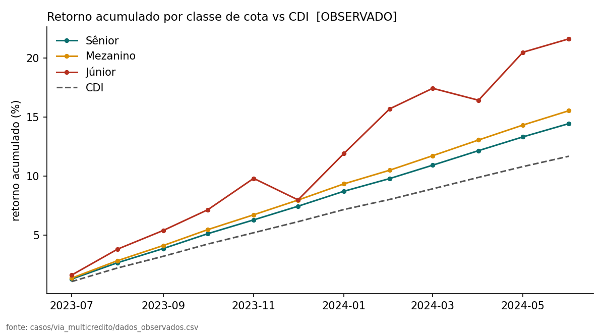
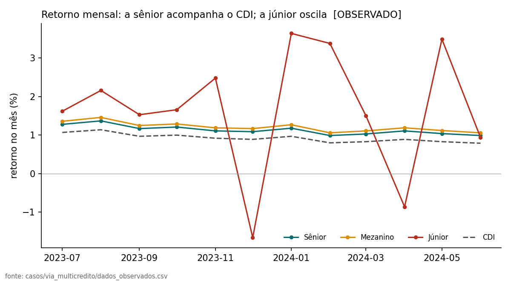
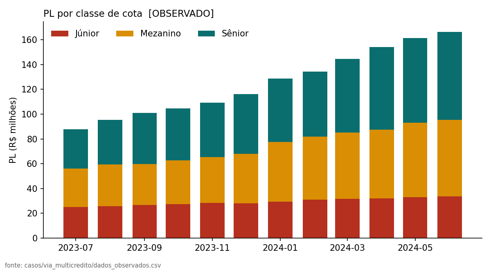
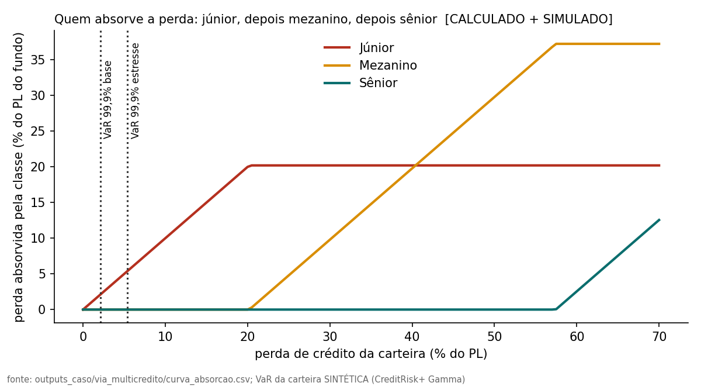

# Caso: FIC FIDC VIA MULTICREDITO

> **Natureza:** dados OBSERVADOS de fonte externa (Austin Rating, relatório de 2024-08-09, janela 2023-07 a 2024-06 (12 competências)) + ponte SIMULADA com a carteira sintética do pipeline. **Defasagem:** o dado mais recente é jun/2024; NÃO representa a situação atual do fundo. Isto é análise de risco, não recomendação de investimento.

- CNPJ 22.175.345/0001-19; FIC de FIDC (fundo que investe em cotas de outros FIDCs); Aberto (D+29), prazo indeterminado.
- Administradora: BTG Pactual Serviços Financeiros S.A. DTVM (cabeçalho do relatório; ver nota de inconsistência em PROVENIENCIA.md). Gestora: Titan Capital Gestão de Recursos Ltda. Custodiante: Banco BTG Pactual S.A.
- Fonte: https://www.austin.com.br/Relatorio/Rating/FIC_FIDC_Via_Multicr%C3%A9dito/11037

## 1. Critérios pedidos (OBSERVADO)

| Classe | PL fim do período (R$ mil) | % do PL | Retorno do último mês | Retorno 12M | CDI 12M | % do CDI | Excesso sobre o CDI (pp) |
|---|---|---|---|---|---|---|---|
| Sênior | 70.734 | 42,6% | 0,99% | 14,45% | 11,68% | 123,7% | 2,47 |
| Mezanino | 61.907 | 37,2% | 1,06% | 15,54% | 11,68% | 133,0% | 3,45 |
| Júnior | 33.586 | 20,2% | 0,94% | 21,62% | 11,68% | 185,1% | 8,90 |

PL total no último mês: R$ 166.227 mil. Cotistas (jun/2024): 770 na sênior e 660 nas subordinadas (mezanino + júnior). A fonte não informa se os cotistas da sênior são pessoas físicas (varejo); **não verificado**.

## 2. Sênior × subordinadas: o que os números mostram (OBSERVADO)

| Classe | Média mensal | Volatilidade mensal | Melhor mês | Pior mês | Meses negativos | Meses abaixo do CDI | Maior queda (pico-vale) |
|---|---|---|---|---|---|---|---|
| Sênior | 1,13% | 0,12% | 1,37% | 0,99% | 0 | 0 | 0,00% |
| Mezanino | 1,21% | 0,12% | 1,46% | 1,06% | 0 | 0 | 0,00% |
| Júnior | 1,66% | 1,63% | 3,64% | -1,66% | 2 | 2 | -1,66% |

Leitura: Sênior e Mezanino ficaram acima do CDI em todos os 12 meses da janela; a Júnior ficou abaixo do CDI em 2 de 12 meses. A oscilação mensal cresce da sênior para a júnior (desvio-padrão de Sênior 0,12%, Mezanino 0,12%, Júnior 1,63%), junto com o retorno acumulado. **Doze observações não sustentam inferência estatística** sobre retorno esperado ou risco futuro.

## 3. Estrutura de subordinação (CALCULADO a partir do OBSERVADO)

No último mês: sênior 42,6% do PL, mezanino 37,2%, júnior 20,2%; subordinação total 57,4%. Na janela, a subordinação total variou de 56,7% a 64,0% e a da júnior (% do PL) de 20,2% a 28,5%. O regulamento (segundo a fonte) exige no mínimo 20% de subordinadas e 10% de júnior; benchmarks: sênior CDI + 2,5% a.a., mezanino CDI + 3,5% a.a..

**Look-through (CALCULADO, aritmética simples).** O fundo é um FIC: investe em cotas de outros FIDCs, e 75,3% do PL estava em um único FIDC (3 FIDCs no total). Se a perda ocorresse só nessa posição, uma queda de 26,8% no valor dela bastaria para zerar a júnior do fundo (20,2% do PL ÷ 75,3%). Isto mostra o efeito da concentração; não é uma previsão, e a posição pode ser de cota sênior, mezanino ou júnior do FIDC investido (a fonte informa só os totais por tipo de cota).

## 4. Ponte com o modelo de risco de crédito (SIMULADO, ilustrativo)

A cascata de 3 classes (júnior → mezanino → sênior, sem excesso de spread, leitura conservadora) foi aplicada à distribuição de perdas **da carteira sintética** de duplicatas do pipeline (CreditRisk+ com setores Gamma), usando a estrutura observada no último mês (mezanino 37,2%, júnior 20,2%). **Esta carteira não é a dos FIDCs investidos pelo fundo.** A pergunta respondida é: *dado um nível de perda de crédito de uma carteira de recebíveis comerciais, qual classe a absorve, e o prêmio observado paga por isso?*

| Cenário | Classe | Anexação–destacamento (% PL) | P(perda) no ciclo | P(zerada) no ciclo | EL no ciclo (% da classe) | EL anual aprox. (% da classe) | Prêmio observado vs CDI |
|---|---|---|---|---|---|---|---|
| base | Júnior | 0,0%–20,2% | 91,488% | 0,000% | 1,637% | 9,82% | 8,90% |
| base | Mezanino | 20,2%–57,4% | 0,000% | 0,000% | 0,000% | 0,00% | 3,45% |
| base | Sênior | 57,4%–100,0% | 0,000% | 0,000% | 0,000% | 0,00% | 2,47% |
| estresse | Júnior | 0,0%–20,2% | 98,634% | 0,000% | 5,221% | 31,33% | 8,90% |
| estresse | Mezanino | 20,2%–57,4% | 0,000% | 0,000% | 0,000% | 0,00% | 3,45% |
| estresse | Sênior | 57,4%–100,0% | 0,000% | 0,000% | 0,000% | 0,00% | 2,47% |

*EL anual aprox. = EL do ciclo × ciclos por ano (linear, sem reposição pelo excesso de spread e sem revolvência do capital). É uma ordem de grandeza. Sem excesso de spread, qualquer perda > 0 atinge a júnior; com ele (não usado aqui) a P(perda) da júnior seria bem menor.*

| Cenário | EL carteira (% PL) | VaR 99% (% PL) | VaR 99,9% (% PL) | ES 99,9% (% PL) | Anexação da mezanino ÷ VaR 99,9% | Anexação da sênior ÷ VaR 99,9% |
|---|---|---|---|---|---|---|
| base | 0,331% | 1,46% | 2,10% | 2,36% | 9,6× | 27,3× |
| estresse | 1,055% | 3,82% | 5,41% | 6,09% | 3,7× | 10,6× |

### O que isto permite concluir

- **Júnior.** Sem excesso de spread, qualquer perda de crédito atinge primeiro a júnior (por isso a P(perda) dela no ciclo é alta). A EL anual aproximada dela é 9,8% da classe no cenário base e 31,3% no estresse, contra um excesso observado de 8,9 pp sobre o CDI (prêmio ÷ EL anual: 0,91× no base e 0,28× no estresse). Ou seja, o prêmio observado da júnior é da ordem da perda esperada do cenário base, e fica abaixo dela no estresse se não houver reposição por excesso de spread. O prêmio observado já é líquido das perdas realizadas no período e o excesso de spread real amortece parte da perda: a comparação dá ordem de grandeza, não um teste.
- **Mezanino e sênior.** A mezanino só perderia com perda da carteira acima de 20,2% do PL e a sênior acima de 57,4%. O VaR 99,9% da carteira sintética é 2,1% (base) e 5,4% (estresse) do PL; a P(perda da sênior) simulada é 0,0000% no estresse. Nesta ponte, portanto, o excesso de 2,5 pp da sênior sobre o CDI **não é explicado por perda esperada de crédito**. Hipóteses não testadas aqui: prêmio de liquidez (cota de FIC com prazo de resgate), complexidade da estrutura, concentração em poucos FIDCs, risco de contraparte e riscos fora do modelo (diluição, fraude, coobrigação).

### O que isto NÃO permite concluir

- Não prevê perda nem retorno do fundo real: a carteira simulada é sintética e o dado observado é de jun/2024.
- Não diz que o prêmio da sênior está "caro" ou "barato" e não é recomendação de compra.
- LGD sistêmica, correlação entre os FIDCs investidos e a hipótese de cauda pesada (cópula t) não entram na ponte; a conclusão sobre a sênior é sensível a elas (ver `docs/METODOLOGIA.md`).

## 5. Auditoria dos dados observados

| Série | Maior diferença absoluta, recalculado − reportado (pp) | Diferença no último mês (pp) | Meses acima da tolerância |
|---|---|---|---|
| cdi | 0,0062 | 0,0018 | 0 |
| senior | 0,0075 | 0,0058 | 0 |
| mezanino | 0,0086 | -0,0031 | 0 |
| junior | 0,0105 | 0,0027 | 0 |

O acumulado reportado pela fonte foi recalculado por capitalização composta dos 12 retornos mensais; as diferenças são de arredondamento (a fonte arredonda a 2 casas). Isto valida a transcrição dos dados, **não** a veracidade da fonte (a agência declara que não audita as informações recebidas).

### Proxy do retorno do fundo (ESTIMADO)

Média das classes ponderada pelo PL do mês anterior: 14,92% acumulado em 11 meses (de 2023-08 a 2024-06) contra 10,50% do CDI no mesmo período. Ignora captações/resgates dentro do mês; serve só como referência de ordem de grandeza.
